# ⚡ PromptDock 3D Ultra

> The Futuristic, Interactive AI Prompt and Web Design Resource Platform for building 3D, animated, scroll-driven websites that actually move. Inspired by the creative engineering of **21st.dev** and **Libraries.dev**.

[](https://github.com/kalyan870/promptdock/actions)
[](LICENSE)
[](#)
[](#)
[](https://promptdock-eight.vercel.app)

---

## 🌐 Live Production Deployments
- **Production URL**: [https://promptdock-eight.vercel.app](https://promptdock-eight.vercel.app)
- **GitHub Repository**: [https://github.com/kalyan870/promptdock](https://github.com/kalyan870/promptdock)

---

## 🏗️ Architecture & 3D Interactive Pipeline

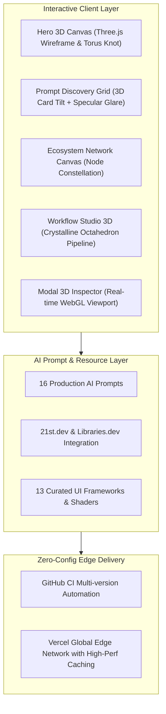

---

## 🌟 Section-Specific 3D Experiences

1. **Hero Experience**: Real-time Three.js WebGL canvas (`#hero-canvas`) featuring a central wireframe Icosahedron, a concentric Torus Knot, an orbital outer ring, orbiting satellites, and 550+ glowing vector particles with mouse inertia and parallax.
2. **Component & Prompt Discovery**: Interactive 3D Perspective Grid with normalized cursor tracking, card tilt physics (`perspective: 1200px`), and dynamic specular glare tracking.
3. **3D Ecosystem & Resources**: Background network graph canvas (`#ecosystem-canvas`) with floating nodes and glowing connection vectors representing modern web animation tools.
4. **Workflow Studio Pipeline**: Real-time 3D assembly visualization (`#workflow-canvas`) featuring 3 rotating crystalline octahedrons (01 Pick Concept -> 02 AI Synthesis -> 03 Ship & Launch).
5. **Modal 3D Inspector**: Dedicated interactive WebGL inspection viewport inside the modal viewer allowing real-time rotation and inspection of 3D geometry alongside system prompts and code.

---

## 🗂️ Master Prompt Discovery Catalog

| Preview | Title | Category | Description |
| :---: | :--- | :---: | :--- |
| 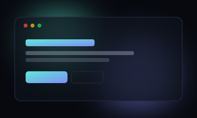 | **Aurora Hero** | Hero | Gradient hero with floating 3D orbs and magnetic CTA. |
| 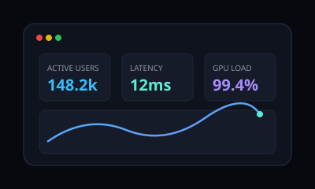 | **Nexus Telemetry** | Dashboard | Futuristic 3D observability dashboard with live metric gauges. |
| 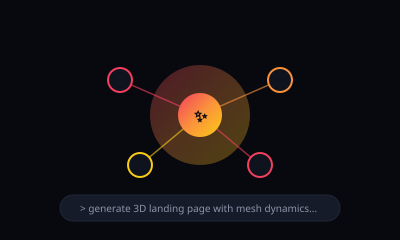 | **Neural Forge** | AI Generator | Autonomous AI web builder interface with neural synthesis graph. |
| 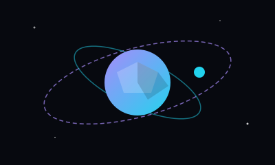 | **Orbit Planet 3D** | Three.js | Interactive 3D low-poly celestial sphere tied to scroll. |
| 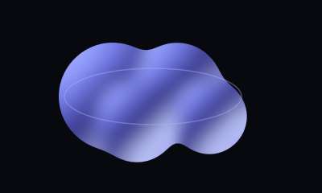 | **Liquid Chrome** | Background | WebGL liquid metal fluid dynamics shader with cursor ripples. |
| 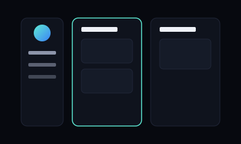 | **SaaS Command** | SaaS | Collaborative workspace with real-time kanban and presence. |
| 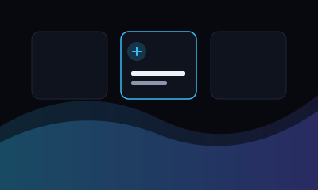 | **Tidewave Landing** | Landing | Scroll-driven landing page with reveal sections. |
| 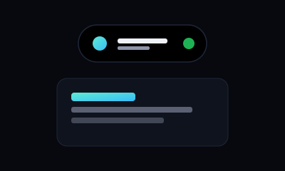 | **Dynamic Island** | Animation | iOS-style morphing floating pill navbar with state transitions. |
| 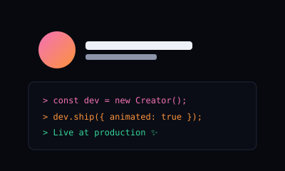 | **Folio Dark** | Portfolio | Minimal developer portfolio with project cards. |
| 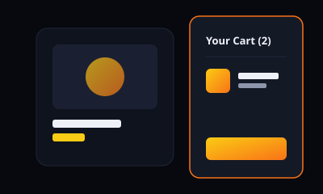 | **Shop Rail** | Ecommerce | Product grid with quick-add cart drawer. |
| 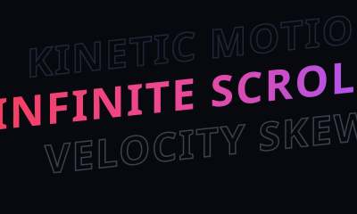 | **Kinetic Velocity** | Typography | Scroll-skewed variable font marquee with depth. |
| 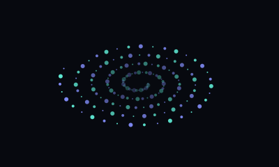 | **Galaxy Vortex** | Three.js | Interactive GPU particle vortex reacting to mouse velocity. |
| 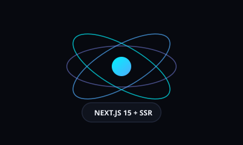 | **Next Reactive** | React & Next.js | Next.js 15 Server Actions with optimistic UI updates. |
| 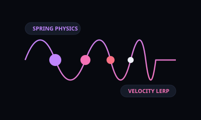 | **Spring Physics** | Animation | Interactive spring gesture playground with velocity lerp. |
| 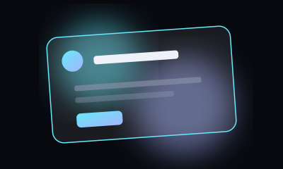 | **Glass Matrix** | Hero | Glassmorphism feature cards over animated 3D mesh. |
| 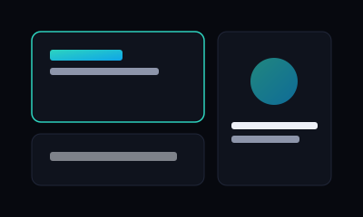 | **Agency One** | Landing | Studio site with case-study carousel. |

---

## 🔗 Free 3D & Animation Ecosystem Directory

| Resource | Link | License | Focus |
| :--- | :--- | :---: | :--- |
| **21st.dev** | [21st.dev](https://21st.dev) | `Free` | The npm for Design Engineers — directory of free, open-source animated React & Tailwind component libraries. |
| **Libraries.dev** | [libraries.dev](https://libraries.dev) | `Free` | Production-ready open-source React UI effect libraries tailored for AI interfaces and voice shaders. |
| **Aceternity UI** | [ui.aceternity.com](https://ui.aceternity.com) | `Free + Pro` | Trending animated components, landing sections and full-page templates for Next.js, Tailwind, and Motion. |
| **Magic UI** | [magicui.design](https://magicui.design) | `Free + Pro` | 20+ animated React components and visual effects designed to drop directly into shadcn/ui codebases. |
| **shadcn/ui** | [ui.shadcn.com](https://ui.shadcn.com) | `Free` | The industry standard, accessible copy-paste component architecture that powers the modern UI ecosystem. |
| **Three.js** | [threejs.org](https://threejs.org) | `Free (MIT)` | The premier JavaScript 3D library for creating WebGL GPU-accelerated graphics in modern web browsers. |
| **React Three Fiber** | [r3f.docs.pmnd.rs](https://r3f.docs.pmnd.rs) | `Free (MIT)` | A powerful React renderer for Three.js. Build declarative, reusable 3D component trees with ease. |
| **GSAP** | [gsap.com](https://gsap.com) | `Free (Standard)` | High-performance JavaScript animation engine for smooth, complex timeline sequencing and ScrollTrigger. |
| **Motion** | [motion.dev](https://motion.dev) | `Free (MIT)` | Production-ready animation and gesture library for React and modern JavaScript. Formerly Framer Motion. |
| **Spline** | [spline.design](https://spline.design) | `Free + Pro` | Interactive 3D design software in the browser with real-time web export and React component integration. |
| **MotionSites** | [motionsites.ai](https://motionsites.ai) | `Freemium` | Curated prompt and inspiration library for animated hero sections with instant copy-paste code. |
| **Spectrum UI** | [github.com/arihantcodes/spectrum-ui](https://github.com/arihantcodes/spectrum-ui) | `Free (Apache 2.0)` | 250+ animated components, bento blocks, and templates built on shadcn/ui and Tailwind. |
| **LottieFiles** | [lottiefiles.com](https://lottiefiles.com) | `Free + Pro` | Lightweight, scalable JSON and dotLottie animations for web apps and interactive UI workflows. |

---

## ⌨️ Keyboard Navigation & Shortcuts

| Key | Action |
| :--- | :--- |
| <kbd>/</kbd> or <kbd>Ctrl</kbd> + <kbd>K</kbd> | Instant spotlight prompt search |
| <kbd>Esc</kbd> | Dismiss prompt detail modal and clean URL hash |
| <kbd>Tab</kbd> / <kbd>Shift</kbd> + <kbd>Tab</kbd> | Full keyboard accessibility navigation |

---

## 🛠️ Local Development & Quick Start

```powershell
# Open repository in VS Code
code C:\Users\KALYAN\.gemini\antigravity\scratch\promptdock

# Run the comprehensive test suite
npm test

# Run local development server
npm start
```

---

## 📄 License
MIT License &copy; 2026 PromptDock 3D Ultra.
