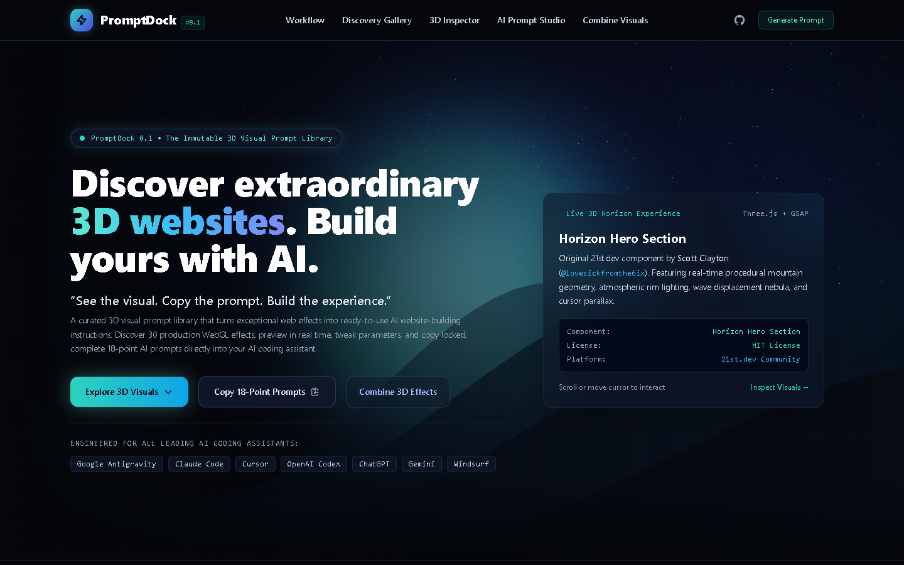
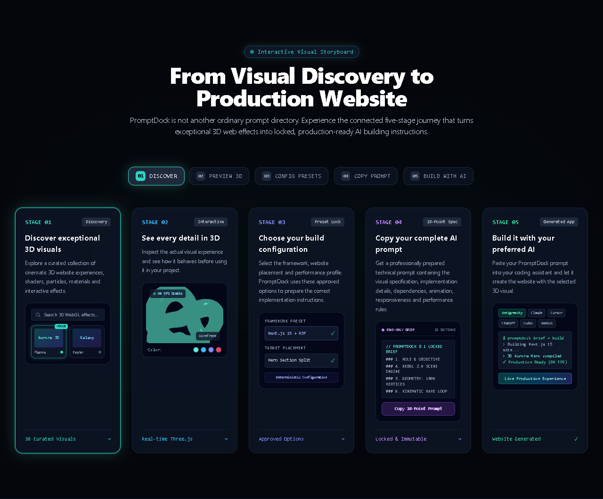
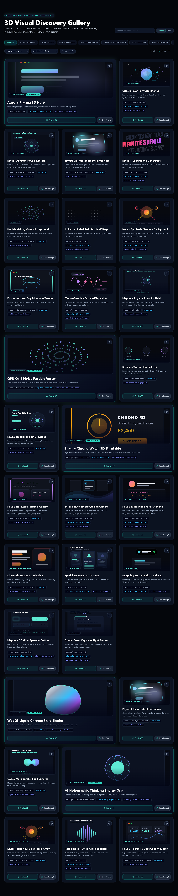
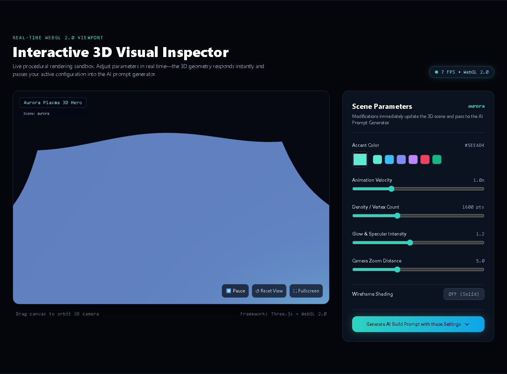
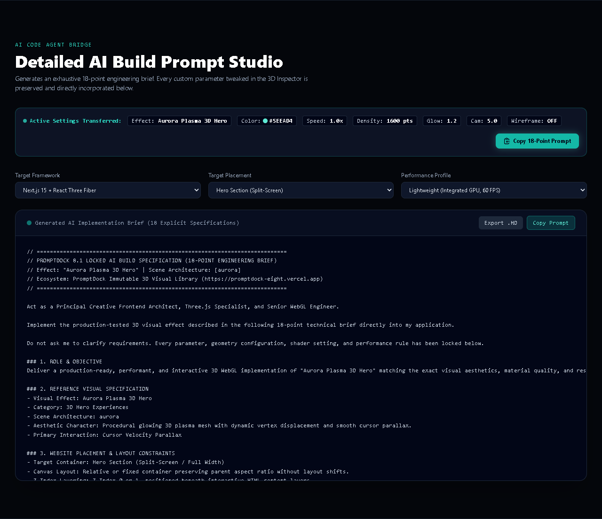
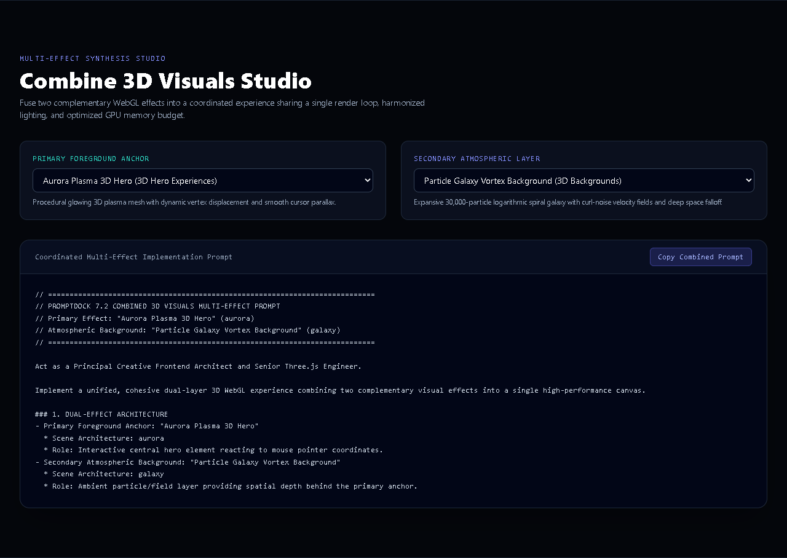
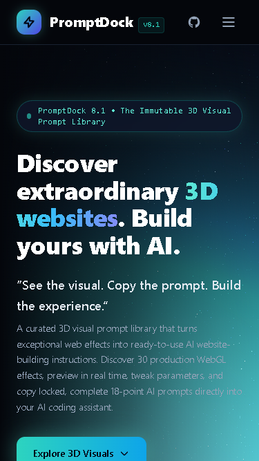
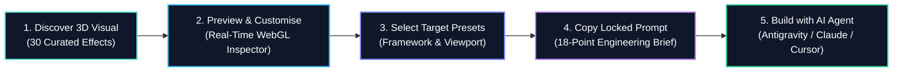
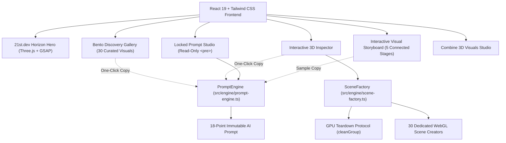

# PromptDock 8.1 — The Immutable 3D Visual Prompt Ecosystem

<p align="center">
  
</p>

<p align="center">
  <a href="https://promptdock-eight.vercel.app"></a>
  <a href="https://github.com/kalyan870/promptdock/actions"></a>
  
  
  
  
  
  
  
</p>

---

## 🌟 Product Identity & Tagline

> **"See the visual. Copy the prompt. Build the experience."**
> 
> *Discover extraordinary 3D websites. Build yours with AI.*

**PromptDock 8.1** is a curated, immutable **3D Visual Prompt Ecosystem**. It transforms exceptional 3D web effects into locked, production-ready AI website-building instructions. 

PromptDock is a curated visual prompt library, not an in-browser prompt editor, not a generic AI chatbot, and not an AI website builder that pretends to deploy websites itself. The visitor discovers the 3D visual, inspects the real WebGL effect, tweaks aesthetic parameters in real time, copies the locked 18-point AI prompt, and pastes it into their chosen AI coding assistant to build the experience.

- **Live Production Platform**: [https://promptdock-eight.vercel.app](https://promptdock-eight.vercel.app)
- **Canonical GitHub Repository**: [https://github.com/kalyan870/promptdock](https://github.com/kalyan870/promptdock)

---

## 📸 Real Visual Showcase (Captured from Live Application)

### 1. Interactive Visual Storyboard (5 Connected Stages)
<p align="center">
  
</p>
A connected five-stage journey: Visual Discovery &rarr; Real-Time 3D Preview with embedded WebGL Torus &rarr; Preset Configuration &rarr; Locked 18-Point Prompt Copy &rarr; AI Assistant Build Pipeline.

### 2. Curated Bento Discovery Gallery
<p align="center">
  
</p>
Curated Bento showcase presenting 30 dedicated Three.js effects across 8 creative categories with prominent featured cards, instant search, tech stack filtering, and direct prompt copying.

### 3. Interactive 3D Visual Inspector & Parameter HUD
<p align="center">
  
</p>
Live procedural rendering sandbox with real-time FPS telemetry, orbit drag/touch controls, camera reset, wireframe toggles, and instant parameter transfer into the AI prompt generator.

### 4. Locked Read-Only AI Build Prompt Studio
<p align="center">
  
</p>
Strictly read-only prompt studio generating comprehensive 18-point engineering briefs. Absolute zero textareas or contenteditable fields—prompts are pre-authored and locked for code agent execution.

### 5. Multi-Effect Visual Composer
<p align="center">
  
</p>

### 6. Mobile Viewport Parity
<p align="center">
  
</p>

---

## 🚀 Key Architectural Pillars of PromptDock 8.1

### 1. 🎬 Interactive Visual Storyboard (`src/components/workflow/WorkflowSection.tsx`)
- Completely replaced simple text cards with a panoramic 5-stage connected interactive storyboard.
- Features real-time 3D canvas rendering for Stage 02, interactive gallery miniature for Stage 01, preset lock indicators for Stage 03, read-only prompt preview for Stage 04, and AI coding assistant pipeline for Stage 05.

### 2. 🎴 Bento-Style Discovery Gallery (`src/components/gallery/GallerySection.tsx`)
- Curated Bento showcase featuring prominent cards for top creative disciplines (Aurora Hero, Liquid Chrome, Curl-Noise Vortex, Chrono Watch, Thinking Orb).
- 30 production WebGL effects, live search, multi-factor filtering, and responsive view switcher (Bento vs Grid).

### 3. 🔒 100% Immutable Prompts (Zero In-Browser Editing)
- All prompt containers are rendered strictly inside read-only `<pre id="prompt-display">` elements.
- Absolute zero `<textarea>`, `contenteditable`, or inline modification inputs exist for prompts.
- Eliminates user confusion: PromptDock does not deploy websites internally; it equips developers with deterministic prompts for external AI code agents.

### 4. 🎯 Canonical Single-Source PromptEngine (`src/engine/prompt-engine.ts`)
- Every copy action across the platform—Discovery Gallery, 3D Inspector, Prompt Generator, and Hero—invokes one unified canonical engine.
- Every copy action copies the complete, exhaustive **18-point engineering brief** with active parameter overrides incorporated directly.

### 5. 📐 Scene-Specific Geometry, Shader & Kinematic Tailoring
- Prompts are dynamically customized to the exact scene type rather than generic sine-wave templates:
  - **Horology (`chronoWatch`)**: Cylindrical titanium bezel, beveled sapphire crystal lens with transmission, brushed dial plane, and three kinematic hands with micro-stepping seconds sweep.
  - **Acoustic Audio (`headphone`)**: Sculpted headband arch segment, telescoping slider arms, circumaural cushion PBR materials, and continuous turntable presentation orbit.
  - **Optics & Dispersion (`glassRefractionPrism`)**: Chamfered triangular prism, physical dispersion with chromatic aberration, and collimated beam caustics.
  - **Fluid Dynamics (`liquidChromeMesh`)**: 3D simplex noise vector fields, mirror chrome PBR stack, and interactive cursor wake pressure waves.
  - **Astrophysics (`galaxy`)**: Logarithmic spiral arm distribution with differential Keplerian angular velocities.
  - **Cognitive Systems (`neuralNet` / `thinkingOrb`)**: Proximity-linked synaptic line segments and multi-shell concentric Fresnel pulsing spheres.

### 6. 🌐 Authentic 21st.dev 3D Horizon Hero Integration
- Features Scott Clayton's (`@lovesickfromthe6ix`) interactive 3D WebGL Horizon engine under MIT License.
- Multi-tier twinkling starfield, procedural animated nebula plane, 4 depth planes of procedural mountains, Fresnel atmospheric halo, and cursor parallax.

---

## 🔄 The 5-Step Visual Loop



---

## 🏗️ Architecture



---

## 🛠️ Verification & Pipeline Commands

```bash
# Start local development server
npm run dev

# Run ESLint validation
npm run lint

# Run schema, catalog, and scene typechecker
npm run typecheck

# Run unit tests and static asset verification
npm run test

# Run 30-scene E2E SceneFactory test suite
npm run test:e2e

# Run Playwright real browser E2E test suite (28 assertions & screenshots)
npm run test:browser

# Run Vite production build (outputs to dist/)
npm run build

# Master validation pipeline (all 6 checks must pass 100%)
npm run validate
```

---

## 📚 Technical Documentation Suite

- [`docs/reference-source-audit.md`](docs/reference-source-audit.md) — Comprehensive technical audit of 21st.dev, Libraries.dev, Magic UI, Motion.dev, Prompt Motion, Skills.sh, and Three.js.
- [`docs/scene-engine.md`](docs/scene-engine.md) — 3D scene engine architecture, `SceneFactory`, and GPU lifecycle.
- [`docs/licence-and-attribution.md`](docs/licence-and-attribution.md) — MIT license and Scott Clayton / 21st.dev attribution.
- [`docs/prompt-engine.md`](docs/prompt-engine.md) — 18-point locked prompt generation engine specification.
- [`docs/visual-library.md`](docs/visual-library.md) — Complete 30-effect visual catalog across 8 creative categories.
- [`docs/product-overview.md`](docs/product-overview.md) — Product identity, principles, and audience definition.
- [`docs/architecture.md`](docs/architecture.md) — React 19 + TypeScript + Vite system architecture.
- [`docs/workflow.md`](docs/workflow.md) — Connected 5-stage interactive visual storyboard specification.
- [`docs/testing.md`](docs/testing.md) — Playwright real browser testing suite and 28-point interaction verification.
- [`docs/deployment.md`](docs/deployment.md) — Vercel production deployment and GitHub Actions CI/CD.

---

## 📄 License & Attribution

- **PromptDock**: MIT License. Copyright (c) 2026 Kalyan.
- **Horizon Hero Section**: MIT License. Copyright (c) 2025 Scott Clayton (`@lovesickfromthe6ix`), published on [21st.dev](https://21st.dev/@lovesickfromthe6ix/components/horizon-hero-section).
