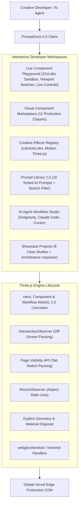

# PromptDock 6.0 — The Real Interactive Creative Developer Platform

<p align="center">
  
</p>

<p align="center">
  <a href="https://promptdock-eight.vercel.app"></a>
  <a href="https://github.com/kalyan870/promptdock/actions"></a>
  
  
  
  
</p>

---

## 🌟 Executive Overview

**PromptDock 6.0** is an interactive creative developer platform engineered for high-performance 3D WebGL interfaces, a **Live Component Playground (inspired by 21st.dev)**, a **Creative Effects Registry (inspired by Libraries.dev)**, an **AI Coding Agent Workflow Studio**, and a robust **Prompt Library 2.0**.

Every section provides real-time interactivity, large visual previews, live configuration sliders, and production-tested code snippets.

- **Production Live Website**: [https://promptdock-eight.vercel.app](https://promptdock-eight.vercel.app)
- **GitHub Repository**: [https://github.com/kalyan870/promptdock](https://github.com/kalyan870/promptdock)

---

## 🚀 Key Highlights in PromptDock 6.0

1. **Live Interactive Component Playground**:
   - Real-time DOM/Three.js sandbox mounting interactive components.
   - Responsive viewport toggles: **Desktop (100%)**, **Tablet (768px)**, and **Mobile (375px)**.
   - Theme switcher (Dark / Light) and canvas background pattern switcher.
   - Real-time parameter sliders (Text, Accent Color, Speed, Glow, Border Radius) updating preview and code instantaneously.
   - Complete copy-pasteable production-ready React / Three.js code.

2. **Accurate Libraries.dev Integration**:
   - Canonical attribution to **[https://libraries.dev](https://libraries.dev)**.
   - Open-source packages from the real ecosystem: `motion`, `three`, `simplex-noise`.
   - Interactive Effects Playground with live sliders and AI agent prompts.

3. **Optimized Three.js Engine Lifecycle**:
   - Single coordinated animation loop with `requestAnimationFrame` and `cancelAnimationFrame`.
   - `IntersectionObserver` automatically pauses off-screen canvases (reducing idle GPU usage to 0%).
   - Page Visibility API (`document.hidden`) pauses rendering when switching tabs.
   - `ResizeObserver` for smooth canvas resizing and aspect ratio recalculation.
   - Explicit GPU memory disposal (`geometry.dispose()`, `material.dispose()`) and WebGL context loss handling.

4. **AI Coding Agent Workflow Section**:
   - Visual architecture pipeline diagram (`images/workflow-agents.svg`).
   - Copyable prompt templates for Google Antigravity, Claude Code, Cursor, Codex, and Gemini.

5. **Showcase Projects (8 Projects)**:
   - Dedicated "View Details" interactive modal.
   - Clear distinction between "Interactive Demonstration" and "Concept Mockup".
   - Architecture breakdowns, stack specifications, and live demonstrations.

6. **Production Engineering Quality Suite**:
   - `npm run lint` — Syntax and tag integrity validation.
   - `npm run typecheck` — Schema and catalog typechecker.
   - `npm test` — Core build and ecosystem verification.
   - `npm run test:e2e` — Headless HTTP server end-to-end testing (41 checks).
   - `npm run build` — Asset integrity check and build manifest generation.
   - `npm run validate` — Full end-to-end pipeline.

---

## 🏗️ Architecture & System Topology



---

## 🛠️ Verification & Pipeline Commands

```bash
# Install dependencies
npm install

# Run local development server
npm run dev

# Run code linter
npm run lint

# Run catalog & schema typechecker
npm run typecheck

# Run unit & filesystem tests
npm test

# Run end-to-end HTTP integration tests
npm run test:e2e

# Run production build
npm run build

# Run all verification checks (100% pass required)
npm run validate
```

---

## 📚 Documentation

The `docs/` folder contains comprehensive technical specifications:
- [`docs/architecture.md`](docs/architecture.md) — System architecture and design principles.
- [`docs/getting-started.md`](docs/getting-started.md) — Developer setup and onboarding.
- [`docs/components.md`](docs/components.md) — Component playground catalog and API.
- [`docs/effects.md`](docs/effects.md) — Libraries.dev effects and shader registry.
- [`docs/prompt-library.md`](docs/prompt-library.md) — Prompt engineering specifications.
- [`docs/3d-engine.md`](docs/3d-engine.md) — Three.js WebGL rendering engine.
- [`docs/performance.md`](docs/performance.md) — GPU lifecycle and performance optimization.
- [`docs/workflow.md`](docs/workflow.md) — AI coding agent workflow pipeline.
- [`docs/testing.md`](docs/testing.md) — Automated testing and QA procedures.
- [`docs/deployment.md`](docs/deployment.md) — Vercel Edge deployment and CI/CD.
- [`docs/roadmap.md`](docs/roadmap.md) — Future enhancements and release trajectory.

---

## 📄 License

MIT License. Copyright (c) 2026 Kalyan.
