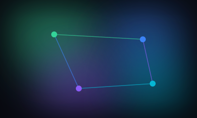
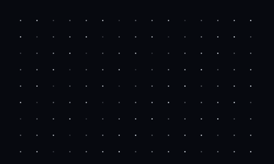
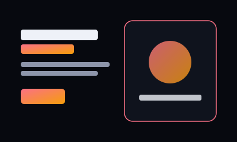
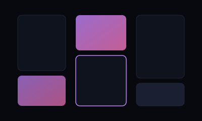
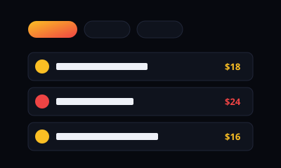

# ⚡ PromptDock

> A curated, copy-paste AI prompt library & animated component directory for crafting websites that actually move.

[](https://github.com/kalyan870/promptdock/actions)
[](LICENSE)
[](#)
[](#)
[](#)
[](https://promptdock-eight.vercel.app)

---

## 🌐 Live Deployments
- **Production URL**: [https://promptdock-eight.vercel.app](https://promptdock-eight.vercel.app)
- **GitHub Repository**: [https://github.com/kalyan870/promptdock](https://github.com/kalyan870/promptdock)

---

## ✨ Features

- 🎯 **16 Ready-to-Ship AI Prompts**: Curated system prompts for Hero sections, Landing pages, Portfolios, Ecommerce, 3D Canvas, WebGL Shaders, Dynamic Islands, and Animated Backgrounds.
- 🎨 **18 Bespoke Vector Illustrations**: Custom high-fidelity SVG mockups for all prompt concepts, social share card, and favicon.
- 💎 **Curated Component Directories & Resources**: Direct integration with leading UI ecosystems including **21st.dev** and **Libraries.dev**.
- 🔍 **Spotlight Search & Filter**: Real-time keyword search with instant `Ctrl + K` or `/` keyboard shortcut.
- ⭐ **Local Favorites & Bookmarking**: Save your favorite prompts to `localStorage` with a dedicated "⭐ Saved" filter.
- 🔗 **Direct URL Deep-Linking**: Share direct links to any prompt (e.g. `/#prompt=aurora-hero`) that automatically scrolls and opens the modal.
- 📑 **Tabbed Modal Inspector**: Toggle between **AI Prompt**, **Key Tech Specs**, and **Starter Code Snippet** for every design.
- 📋 **One-Click Clipboard Copy**: Instantly copy full system prompts optimized for Claude, Cursor, v0, ChatGPT, or Gemini.
- 📱 **Fully Responsive & Dark-Themed**: Handcrafted responsive UI with CSS glassmorphism, glowing gradient orbs, and scroll reveal effects.
- 🚀 **Zero Build Dependencies**: Pure HTML5, modern CSS, and vanilla JavaScript. Runs anywhere without heavy bundling.

---

## 🗂️ Prompt Library Catalog

| Preview | Title | Category | Description |
| :---: | :--- | :---: | :--- |
|  | **Aurora Hero** | Hero | Gradient hero with floating orbs and magnetic CTA. |
|  | **Tidewave Landing** | Landing | Scroll-driven landing page with reveal sections. |
|  | **Folio Dark** | Portfolio | Minimal developer portfolio with project cards. |
|  | **Shop Rail** | Ecommerce | Product grid with quick-add cart drawer. |
|  | **Orbit Scene** | 3D | Interactive 3D object that follows scroll. |
|  | **Mesh Glow** | Background | Animated mesh-gradient canvas background. |
|  | **Halftone Tide** | Background | Halftone dot wave background effect. |
|  | **Split Hero** | Hero | Two-column hero with rotating word headline. |
|  | **Agency One** | Landing | Studio site with case-study carousel. |
|  | **Gallery Wall** | Portfolio | Photographer portfolio with masonry layout. |
|  | **Menu Board** | Ecommerce | Restaurant menu with sticky category tabs. |
|  | **Glass Cards** | Hero | Glassmorphism feature cards over a gradient. |
|  | **Liquid Metal** | Background | WebGL liquid metal fluid dynamics shader with cursor interaction. |
|  | **Dynamic Island** | Hero | iOS-style morphing floating pill with state transitions. |
|  | **Kinetic Type** | Typography | Scroll-skewed variable font marquee with depth. |
|  | **Particle Cloud** | 3D | Interactive GPU particle vortex reacting to mouse velocity. |

---

## 🔗 Free Resources & Animation Directories

| Resource | Link | License | Description |
| :--- | :--- | :---: | :--- |
| **21st.dev** | [21st.dev](https://21st.dev) | `Free` | The npm for Design Engineers — directory of free, open-source animated React & Tailwind component libraries. |
| **Libraries.dev** | [libraries.dev](https://libraries.dev) | `Free` | Production-ready open-source React UI effect libraries tailored for AI interfaces, voice visualizers, and glowing shaders. |
| **Aceternity UI** | [ui.aceternity.com](https://ui.aceternity.com) | `Free + Pro` | Animated sections, effects and full-page templates for Next.js, Tailwind, and Framer Motion. |
| **Magic UI** | [magicui.design](https://magicui.design) | `Free + Pro` | 20+ animated React components and effects that drop smoothly into any shadcn/ui project. |
| **Spectrum UI** | [github.com/arihantcodes/spectrum-ui](https://github.com/arihantcodes/spectrum-ui) | `Free` | 250+ animated components, blocks, and templates built on shadcn/ui under Apache 2.0 license. |
| **shadcn/ui** | [ui.shadcn.com](https://ui.shadcn.com) | `Free` | The accessible, copy-paste component architecture that modern web animation libraries extend. |
| **MotionSites** | [motionsites.ai](https://motionsites.ai) | `Freemium` | Curated prompt and design library for animated hero sections with instant copy. |
| **Libraries.io** | [libraries.io](https://libraries.io) | `Open Data` | Search and discover open-source packages, dependency trees, and licenses across 30+ package managers. |

---

## ⌨️ Keyboard Shortcuts

| Shortcut | Action |
| :--- | :--- |
| <kbd>/</kbd> or <kbd>Ctrl</kbd> + <kbd>K</kbd> | Focus search bar |
| <kbd>Esc</kbd> | Close prompt modal |
| <kbd>Tab</kbd> / <kbd>Shift</kbd> + <kbd>Tab</kbd> | Accessible keyboard navigation |

---

## 🛠️ Getting Started Locally

### 1. Open in VS Code
```powershell
code C:\Users\KALYAN\.gemini\antigravity\scratch\promptdock
```

### 2. Run Tests
```powershell
npm test
```

### 3. Run Locally
```powershell
npm start
```
Then visit `http://localhost:3000` in your browser.

---

## 🤝 Contributing
Contributions are warmly welcomed! Please read [CONTRIBUTING.md](CONTRIBUTING.md) before submitting a Pull Request.

---

## 📄 License
MIT License &copy; 2026 PromptDock
