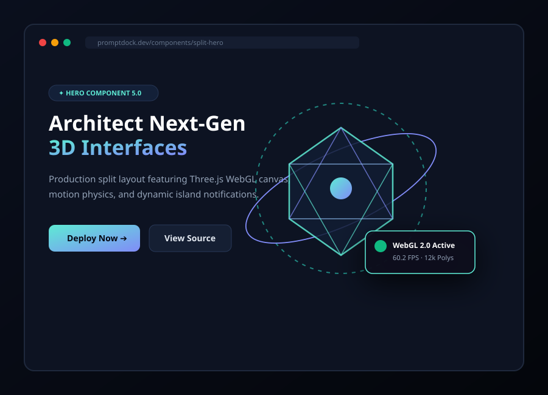
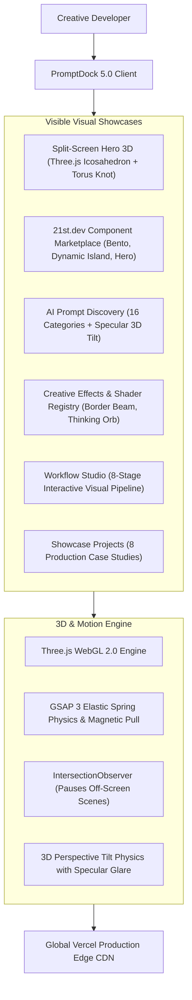
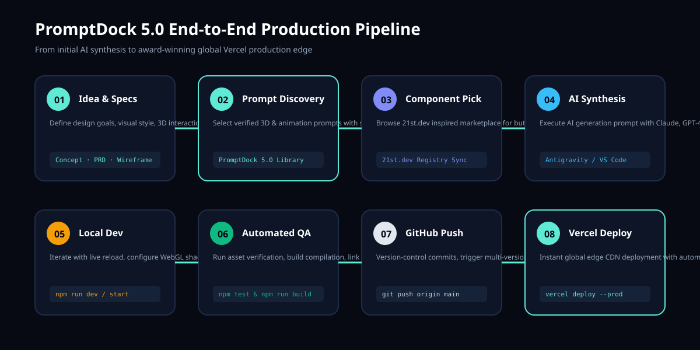

# PromptDock 5.0 — The Creative Developer Platform

<p align="center">
  
</p>

<p align="center">
  <a href="https://promptdock-eight.vercel.app"></a>
  <a href="https://github.com/kalyan870/promptdock/actions"></a>
  
  
  
</p>

---

## 🌟 Executive Overview

**PromptDock 5.0** is an interactive creative developer platform engineered for high-performance 3D WebGL interfaces, AI prompt discovery, **21st.dev** component marketplace synchronization, and **Libraries.dev** open-source dependency exploration.

Every major section visibly demonstrates its technology with **large, high-resolution preview compositions, real-time WebGL canvases, and copy-paste code snippets**.

- **Production Live Website**: [https://promptdock-eight.vercel.app](https://promptdock-eight.vercel.app)
- **GitHub Repository**: [https://github.com/kalyan870/promptdock](https://github.com/kalyan870/promptdock)

---

## 🎨 Visual Showcase & Feature Architecture



---

## 🧩 Visual Component Marketplace (21st.dev-Inspired)

| Component | Category | Preview Asset | Stack |
| :--- | :--- | :--- | :--- |
| **Split Screen 3D Hero** | Hero | `images/comp-hero.svg` | React 19 + Three.js + Tailwind |
| **Dynamic Island Dock** | Navigation | `images/comp-navbar.svg` | Framer Motion + Tailwind |
| **Interactive Button Suite** | Buttons | `images/comp-buttons.svg` | GSAP 3 + CSS Keyframes |
| **3D Perspective Tilt Cards** | Cards | `images/comp-cards.svg` | CSS 3D Transforms + Vanilla JS |
| **Glassmorphic Pricing Table** | Pricing | `images/comp-pricing.svg` | Tailwind + Framer Motion |
| **Asymmetrical Bento Grid** | Bento | `images/comp-bento.svg` | CSS Grid + Canvas2D |
| **AI Copilot Chat Interface** | AI Chat | `images/comp-chat.svg` | React + Lucide Icons |
| **Multi-Step Inquiry Form** | Forms | `images/comp-forms.svg` | React Hook Form + Zod |
| **Kinetic Variable Typography** | Animated Text | `images/comp-text.svg` | CSS Variable Fonts + GSAP |
| **Three.js 3D Viewport** | 3D Viewport | `images/comp-3d.svg` | Three.js WebGL Canvas |
| **Mesh Gradient & Starfield** | Backgrounds | `images/comp-backgrounds.svg` | GLSL Fragment Shader |

---

## ⚡ Creative Effects Registry (Libraries.dev-Inspired)

| Effect | Category | Preview Asset | Install Command | License |
| :--- | :--- | :--- | :--- | :--- |
| **Border Beam Effect** | Shader & Border FX | `images/lib-border-beam.svg` | `npm i @promptdock/border-beam` | MIT |
| **AI Thinking Orb** | 3D Shader FX | `images/lib-thinking-orb.svg` | `npm i @promptdock/thinking-orb` | MIT |
| **Liquid Metal Chrome** | WebGL Normal Maps | `images/lib-liquid-metal.svg` | `npm i @promptdock/liquid-chrome` | MIT |
| **Gooey Fluid Blob** | SVG Filters | `images/lib-gooey.svg` | `npm i @promptdock/gooey-blob` | MIT |
| **Audio Spectrum Bars** | WebAudio Visualizer | `images/lib-voice-viz.svg` | `npm i @promptdock/voice-spectrum` | MIT |
| **Magnetic Spring Physics** | Motion & Physics | `images/lib-magnetic.svg` | `npm i @promptdock/magnetic-ui` | MIT |

---

## 🚀 8-Stage Interactive Workflow

<p align="center">
  
</p>

1. **Idea & Specifications**: Define requirements, 3D interaction models, and tech choices.
2. **Prompt Discovery**: Select tested 3D and animation prompts from the catalog.
3. **Component Selection**: Browse 21st.dev-inspired UI recipes.
4. **AI Code Generation**: Execute prompt in Claude, GPT-4o, or Gemini inside your IDE.
5. **Local Development**: Live-reload testing on `http://localhost:3000`.
6. **Automated QA**: Run `npm test && npm run build` for 63+ assertions and asset checks.
7. **GitHub Push**: Trigger multi-version Node.js matrix GitHub Actions CI.
8. **Vercel Deploy**: Deploy globally to Vercel edge with immutable asset caching.

---

## 📁 Project Structure

```
promptdock/
├── .github/
│   └── workflows/
│       └── ci.yml                 # Node.js 18.x, 20.x, 22.x CI Matrix
├── docs/
│   ├── architecture.md            # System architecture & Mermaid flowcharts
│   ├── getting-started.md         # Local setup & keyboard shortcuts
│   ├── components.md              # 21st.dev component marketplace reference
│   ├── visual-system.md           # Visual hierarchy & design tokens
│   ├── 3d-engine.md               # Three.js WebGL scenes & shader pipelines
│   ├── workflow.md                # 8-stage interactive engineering pipeline
│   ├── testing.md                 # Automated QA & test runner specs
│   ├── deployment.md              # Vercel global edge CDN configuration
│   └── roadmap.md                 # Upcoming features (5.1 & WebGPU)
├── images/                        # 53 Production Vector SVG Assets
├── index.html                     # Core PromptDock 5.0 application
├── package.json                   # Project metadata & npm scripts
├── build.js                       # Production build compilation script
├── test-build.js                  # Master 63-point automated test suite
├── vercel.json                    # Edge headers & caching configuration
├── CHANGELOG.md                   # Version history
└── README.md                      # Platform documentation
```

---

## 🛠️ Local Development & Production Build

```bash
# 1. Install dependencies (zero external node packages required)
npm install

# 2. Run the automated test runner (63 assertions)
npm test

# 3. Run production build validation
npm run build

# 4. Start the local server
npm start
```

Visit [http://localhost:3000](http://localhost:3000) to view the application locally.

---

## 📜 License

MIT License &copy; 2026 Kalyan. All community resources attributed to their respective owners.
