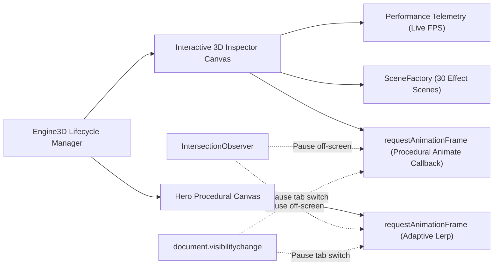

# 3D WebGL Rendering Architecture

PromptDock 7.1 features a modular Three.js WebGL 2.0 rendering engine optimized for standard developer laptops and integrated graphics, featuring dedicated procedural scene factories for all 30 visuals and real-time performance telemetry.

## Rendering Pipeline



## SceneFactory: 30 Specialized 3D Visual Scenes
Rather than relying on generic fallback shapes, `SceneFactory` produces tailored procedural Three.js architectures matching each visual's category and character:

1. `aurora` — Undulating sine-wave vertex plane with multi-tonal plasma color gradients.
2. `planet` — Textured sphere surrounded by dual concentric particle rings.
3. `abstractTorus` — Interlocking dual TorusKnots with opposing rotational axes.
4. `spatialGlass` — Multi-layered translucent octahedrons with simulated physical depth.
5. `kineticType` — Extruded 3D kinetic wireframe matrices with floating typographic anchors.
6. `galaxy` — 5-arm logarithmic spiral particle field with galactic core density.
7. `starfieldWarp` — Deep z-axis velocity warp starfield with trail stretches.
8. `neuralNet` — Synaptic node graph interconnected by dynamic 3D line segments.
9. `terrain` — Dual-frequency noise displaced grid plane simulating a holographic digital landscape.
10. `reactiveParticles` — Dynamic particle cluster with interactive pointer vector repulsion.
11. `magneticAttractor` — Multi-orbit particle swarm orbiting dynamic focal attractors.
12. `curlVortex` — Procedural curl-noise vortex with rotational velocity gradients.
13. `flowField` — Directional vector field with animated particle streamlines.
14. `headphone` — Stylized procedural headphones with curved headband and dual ear cushions.
15. `chronoWatch` — Luxury watch case featuring rotating hour, minute, and second dial hands.
16. `hardwareTerminal` — Floating cyberpunk chassis with glowing terminal grid display.
17. `scrollCameraTrack` — Spline track displaying waypoint cameras along a motion curve.
18. `multiplaneParallax` — 4 distinct depth planes with differential z-axis parallax.
19. `sectionDissolve` — Dual intersecting geometric volumes transitioning across phases.
20. `tiltCardStack` — 3D stacked card deck responding to mouse tilting vectors.
21. `morphingPill` — Organic capsule mesh morphing along radial vertices.
22. `magneticButtonMesh` — Specular convex button mesh with dynamic surface highlights.
23. `borderBeamRunner` — Rectangular border path with an animated glowing tracer beam.
24. `liquidChromeMesh` — High-specular organic fluid mesh with metallic chrome reflections.
25. `glassRefractionPrism` — Triangular crystal prism scattering spectral highlights.
26. `gooeyCluster` — Interpenetrating metaball cluster with pulsating gravitational cohesion.
27. `thinkingOrb` — Concentric nested wireframe spheres pulsating with AI processing phases.
28. `neuralGraph` — Distributed cluster nodes with pulsating synaptic signal packets.
29. `voiceRing` — Radial frequency equalizing rings fluctuating with audio waves.
30. `telemetryGrid` — Holographic cylindrical data matrix with rotating coordinate markers.

## Live Real-Time FPS Measurement
The inspector tracks render deltas between consecutive frames using high-resolution timestamps:
```javascript
const now = performance.now();
const delta = now - lastTime;
lastTime = now;
frameCount++;
if (now - lastFpsUpdate >= 500) {
  const currentFps = Math.round((frameCount * 1000) / (now - lastFpsUpdate));
  // Updates #fps-display with live telemetry
}
```
