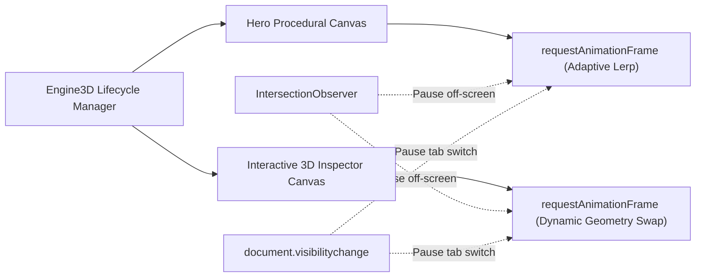

# 3D WebGL Rendering Architecture

PromptDock 7.0 uses a modular Three.js WebGL 2.0 rendering engine optimized for standard developer laptops and integrated graphics.

## Rendering Pipeline

## Primitives Supported in Live Inspector
- `icosahedron`: Wireframe and PBR shaded regular icosahedrons with dual-color emissive highlights.
- `torusKnot`: Smooth parametric curves with brushed metal specular reflections.
- `sphere`: High-density latitude/longitude spheres with orbital satellite tracks.
- `galaxy`: Multi-arm logarithmic spiral particle distribution with randomized radius decay.
- `particles`: N-body particle force-field arrays.
- `terrain`: Real-time Perlin-noise displaced plane geometry.
- `cube`: Translucent frosted glass box with physical transmission.
- `thinkingOrb`: Nested concentric volumetric wireframe spheres with pulsating phase.
