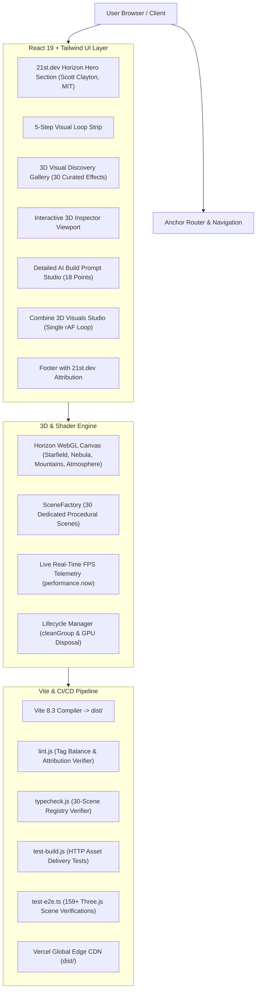

# PromptDock 7.2 — System Architecture

PromptDock 7.2 is built on a modular React 19 + TypeScript + Vite architecture delivering high-performance WebGL 2.0 rendering, seamless 21st.dev component integration, and parameter-transferred AI build prompt generation.

## Key Architectural Highlights

1. **21st.dev Horizon Hero Section Integration**:
   - Original 3D component authored by Scott Clayton (`@lovesickfromthe6ix`) under MIT License.
   - Custom GLSL vertex and fragment shaders for multi-layer twinkling starfields and wave-displaced nebula planes.
   - 4 procedural mountain geometry layers with depth-based parallax and atmospheric Fresnel rim lighting.

2. **Dedicated SceneFactory (30 Independent 3D Scenes)**:
   - Zero fallback fall-through: Every visual has an explicit dedicated procedural Three.js generator.
   - Completely separated `galaxy` (5-arm logarithmic spiral) from `curlVortex` (turbulent fluid advection), and `neuralNet` (structured lattice) from `neuralGraph` (packet transmissions).

3. **GPU Memory Leak Elimination**:
   - `SceneFactory.cleanGroup()` recursively cleans geometries, materials, material arrays, and allocated textures.
   - Resets `group._customUpdate = null` to ensure old frame loops terminate immediately upon scene switching.

4. **Parameter Transfer to 18-Point Build Prompt**:
   - User adjustments in Inspector sliders are preserved in state and directly injected into the 18-point detailed AI build prompt.
