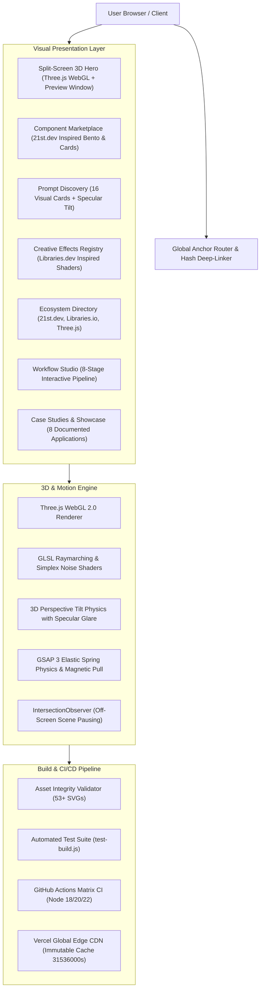

# PromptDock 5.0 — System Architecture

PromptDock 5.0 is an interactive creative developer platform engineered for high-performance 3D WebGL experiences, AI prompt discovery, 21st.dev component marketplace synchronization, and Libraries.dev open-source dependency exploration.

## Key Architectural Decisions

1. **Client-Side WebGL Rendering**:
   - Zero-dependency Three.js r128 loaded via CDN for rapid browser parsing and zero runtime build overhead.
   - Separate canvas contexts for each section (`#hero-canvas`, `#component-canvas`, `#workflow-canvas`, `#modal-3d-canvas`).
   - Dynamic canvas resizing and high-DPI scaling (`Math.min(window.devicePixelRatio, 2)`).

2. **IntersectionObserver Performance Guard**:
   - WebGL render loops are automatically throttled when off-screen to preserve 60 FPS on laptops with integrated graphics.

3. **Asset System**:
   - 53 verified vector illustrations and architecture blueprints in `images/`.
   - Scalable, sharp on Retina displays, and zero external hotlink risks.
