# PromptDock 8.1 — System Architecture

PromptDock 8.1 is built on a modular React 19 + TypeScript + Vite architecture delivering high-performance WebGL 2.0 rendering, 21st.dev component integration, canonical 18-point prompt generation, and Playwright browser E2E verification.

```mermaid
graph TD
    Client["User Browser / Client"] --> Presentation["React 19 + Tailwind UI Layer"]
    
    subgraph Presentation ["Presentation Layer"]
      Hero["21st.dev Horizon Hero Section (Scott Clayton, MIT)"]
      Storyboard["Interactive Visual Storyboard (5 Connected Stages)"]
      Gallery["Curated Bento Gallery (30 Dedicated Effects)"]
      Inspector["Interactive 3D Inspector Viewport"]
      PromptStudio["Locked AI Prompt Studio (Read-Only &lt;pre&gt;)"]
      CombineStudio["Combine 3D Visuals Studio (Single rAF Loop)"]
      Footer["Footer with v8.1 Release Badge"]
    end
    
    subgraph Engine ["3D & Prompt Engine"]
      HorizonEngine["Horizon WebGL Canvas (Starfield, Nebula, Mountains, Atmosphere)"]
      SceneFac["SceneFactory (30 Dedicated Procedural Scenes)"]
      PromptEng["Canonical PromptEngine (18-Point Tailored Briefs)"]
      Telemetry["Live Real-Time FPS Telemetry (performance.now)"]
      Lifecycle["Lifecycle Manager (cleanGroup & GPU Disposal)"]
    end
    
    subgraph Pipeline ["Validation & CI/CD Pipeline"]
      Vite["Vite 8.3 Compiler -> dist/"]
      Linter["lint.js (Tag Balance & Attribution Verifier)"]
      Typechecker["typecheck.js (30-Scene Registry Verifier)"]
      UnitTests["test-build.js (HTTP Asset Delivery Tests)"]
      SceneTests["test-e2e.ts (SceneFactory Unit Tests)"]
      PlaywrightTests["test-browser-e2e.ts (28 Browser Interactions)"]
      VercelEdge["Vercel Global Edge CDN (dist/)"]
    end
    
    Presentation --> Engine
    Engine --> Pipeline
```

## Key Architectural Highlights

1. **Interactive Visual Storyboard (`WorkflowSection.tsx`)**:
   - Replaced static text cards with a connected panoramic 5-stage storyboard.
   - Embedded real-time Three.js canvas in Stage 02, interactive gallery miniature in Stage 01, preset lock indicators in Stage 03, read-only prompt preview in Stage 04, and AI coding assistant pipeline in Stage 05.

2. **Curated Bento Discovery Gallery (`GallerySection.tsx`)**:
   - Multi-tier bento showcase highlighting top visuals in Hero, Shaders, Particles, Products, and AI disciplines.
   - Preserves search, category filtering, and direct canonical prompt copying.

3. **Canonical Single-Source PromptEngine (`prompt-engine.ts`)**:
   - Centralized prompt generation for all copy actions across the platform.
   - Tailored geometry, shaders, lighting, and animation formulas for each specific visual effect.
   - Zero in-browser prompt editing: all prompts rendered inside read-only `<pre>`.

4. **Playwright Automated Browser Testing (`test-browser-e2e.ts`)**:
   - Real Chromium browser testing verifying 28 critical user interactions, console error audits, network request tracking, and responsive layout validation.
   - Real webp screenshot captures committed to `docs/assets/screenshots/`.
