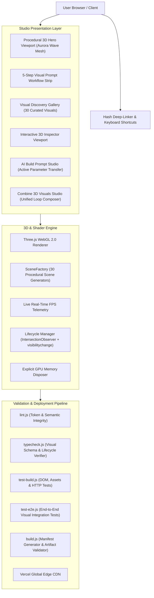

# PromptDock 7.1 — System Architecture

PromptDock 7.1 is a focused, high-precision **3D Website Visual Prompt Studio** engineered for high-performance WebGL discovery, real-time procedural parameter inspection, parameter-transferred AI prompt generation, and multi-visual synthesis.

## Key Architectural Decisions

1. **Client-Side Procedural 3D WebGL Rendering**:
   - Zero-dependency Three.js r128 loaded via CDN for instant page loads without heavy build bundler baggage.
   - Dedicated `SceneFactory` with 30 distinct procedural scene factories mapped via `sceneType`, avoiding heavy external 3D asset downloads.
   - High-DPI scaling capped at `Math.min(window.devicePixelRatio, 2)` to protect mobile GPUs.

2. **Full Parameter Transfer to Prompt Generator**:
   - User tweaks to accent color, speed, density, glow, and camera distance in the Inspector are captured in state and directly injected into the AI Build Prompt.
   - Visible `#config-summary-bar` keeps users informed of active parameters.

3. **GPU Lifecycle & Battery Preservation**:
   - Render loops automatically suspended when canvases exit viewport (`IntersectionObserver`) or when the user switches tabs (`visibilitychange`).
   - Clean mesh and material disposal on geometry teardown.

4. **Streamlined 5-Step Visual Loop**:
   - Clean separation of concerns: Discover → Preview & Customise → Generate Prompt → Copy → Build with AI.
   - Elimination of redundant website modification UI while keeping robust codebase-preservation directives in the generated AI build prompt.
